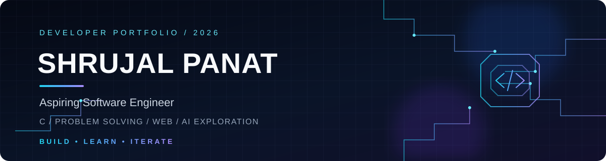

  
  
  

### Aspiring Software Engineer · C Programmer · Curious Builder

*Learning the fundamentals, solving problems, and turning ideas into useful software.*

---

## 01 / About me

Hey, I'm **Shrujal Panat**, a first-year **B.Tech Computer Science and Engineering** student at **The NorthCap University (NCU)**.

I'm building my foundation one project and one problem at a time. I enjoy understanding how things work, experimenting with ideas, and improving my code through debugging and iteration. Right now, I'm focused on strengthening my C programming and problem-solving fundamentals while exploring web development and AI-powered applications.

- **Building:** practical projects that solve real problems
- **Practising:** programming fundamentals and coding challenges
- **Exploring:** web technologies and AI-assisted application ideas
- **Growing:** through experimentation, feedback, and open-source workflows

> I don't need to know everything to start building. I need to stay curious, keep learning, and finish what I start.

## 02 / Technology radar

| AREA | CURRENT FOCUS |
|:--|:--|
| **Programming** |  |
| **Web development** |  |
| **Tools & workflow** |  |
| **AI & emerging tech** |  |

  

These labels describe my current practice and exploration—not a claim of mastery. My focus and stack will evolve as I build more.

## 03 / Selected builds

### FindIt AI — Campus Lost & Found

A student-focused lost-and-found web application designed to help people report lost belongings, browse found items, and submit claims in one organised place. This is my first complete website and an important step in learning how to turn a real-world problem into a working project.

**Explore:** [Source code & project details](https://github.com/ShrujalPanat/FindIt-AI)

### Coding practice repositories

- **[HackerRank solutions](https://github.com/ShrujalPanat/hackerrank-solutions)** — a growing collection of C practice solutions and programming exercises.
- **[LeetCode problems](https://github.com/ShrujalPanat/LEETCODE---Problems)** — solutions organised around the problems I practise.
- **[FOCP-I C Programming Workspace](https://github.com/ShrujalPanat/FOCP-I-C-Programming-Workspace)** — coursework and practice supporting my C programming fundamentals.

  <a href="https://github.com/ShrujalPanat?tab=repositories"><b>VIEW ALL REPOSITORIES →</b></a>

## 04 / Problem-solving log

I use coding challenges to practise translating a problem into clear steps, testing edge cases, and making my solutions easier to understand.

I’m prioritising consistency and understanding over chasing rankings. I’ll add my HackerEarth profile once I have a confirmed public profile URL.

## 05 / Learning queue

| STATUS | LEARNING TRACK |
|:--:|:--|
| **01** | **Programming foundations** — writing readable C and understanding core concepts |
| **02** | **Data structures & algorithms** — building logic through practice |
| **03** | **Problem solving** — patterns, edge cases, and step-by-step reasoning |
| **04** | **Web development** — building usable, responsive interfaces |
| **05** | **Git & collaboration** — branches, commits, documentation, and open source |
| **06** | **AI-powered applications** — exploring how useful AI features can fit into real products |

## 06 / GitHub activity

Stats and charts are served by third-party services and may occasionally be unavailable or delayed. Language cards reflect repository contents, not a formal measure of skill. If a widget fails, the links above still lead to the source profile and repositories.

## 07 / Build philosophy

### Curiosity → Experiments → Working software

**Start small. Understand deeply. Build deliberately. Improve continuously.**

I’m here to document the process—not just the finished result. Every repository is a snapshot of what I’m learning and what I can improve next.

## 08 / Find me online

---

**Thanks for visiting. The journey is in progress.**

Designed with intention · Built while learning · Updated as I grow

